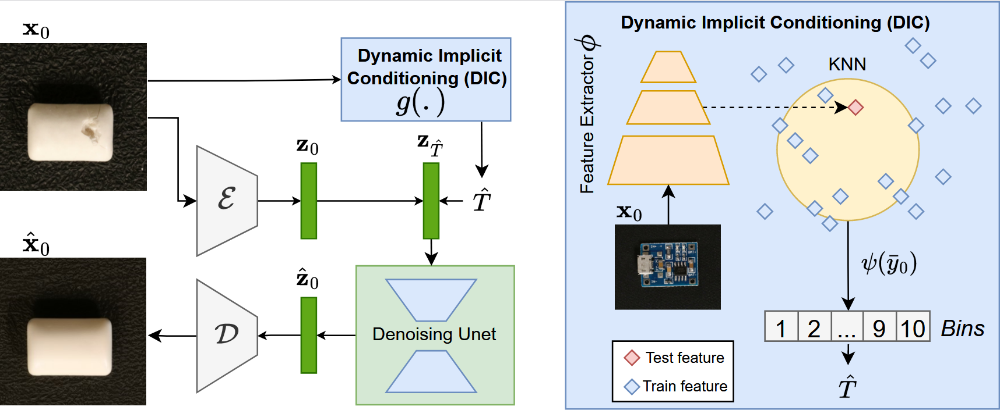

# Dynamic Addition of Noise in a Diffusion Model for Anomaly Detection

This repo contains the official implementation of [Dynamic Addition of Noise in a Diffusion Model for Anomaly Detection](https://openaccess.thecvf.com/content/CVPR2024W/VAND/papers/Tebbe_Dynamic_Addition_of_Noise_in_a_Diffusion_Model_for_Anomaly_CVPRW_2024_paper.pdf)
## Setup
**Install dependencies:**
```
pip install -r requirements.txt
```
For [consistency decoder](https://github.com/openai/consistencydecoder):
```
$ pip install git+https://github.com/openai/consistencydecoder.git
```
**Create folder structure** for model checkpoints and results like:
```
checkpoints
|--- VisA
|--- BTAD
|--- MVTec
results
|--- category_name
```
**Data:** <br> 
[MVTec](https://www.mvtec.com/company/research/datasets/mvtec-ad/downloads) can be used as is. <br>
For [VisA](https://github.com/amazon-science/spot-diff) please structure like:
```
VisA_pytorch
|--- candle
|-----|----- ground_truth
|-----|----- test
|-----|-------|------- good 
|-----|-------|------- bad 
|-----|----- train
|-----|-------|------- good
|--- capsules
|--- ...
```
## Run the model
For **training** of the model run:
```
python main.py
```
For **evaluating** model performance run:
```
python main.py --eval True
```
## Reproduction of Results
For **reproducing** of the results, please refer to this hyperparameter settings:
```
VisA_dict = {"candle": {"eta2": 8, "DA_epochs": 0, "DA_fine_tune": 1, "checkpoint_epochs": 50},
"capsules": {"eta2": 7, "DA_epochs": 0, "DA_fine_tune": 1, "checkpoint_epochs": 200},
"cashew": {"eta2": 8, "DA_epochs": 3, "DA_fine_tune": 1, "checkpoint_epochs": 100},
"chewinggum": {"eta2": 10, "DA_epochs": 2, "DA_fine_tune": 1, "checkpoint_epochs": 150},
"fryum": {"eta2": 7, "DA_epochs": 2, "DA_fine_tune": 1, "checkpoint_epochs": 200},
"macaroni1": {"eta2": 10, "DA_epochs": 0, "DA_fine_tune": 1, "checkpoint_epochs": 300},
"macaroni2": {"eta2": 9, "DA_epochs": 3, "DA_fine_tune": 1, "checkpoint_epochs": 150},
"pcb1": {"eta2": 10, "DA_epochs": 1, "DA_fine_tune": 1, "checkpoint_epochs": 250},
"pcb2": {"eta2": 10, "DA_epochs": 0, "DA_fine_tune": 1, "checkpoint_epochs": 300},
"pcb3": {"eta2": 10, "DA_epochs": 0, "DA_fine_tune": 1, "checkpoint_epochs": 250},
"pcb4": {"eta2": 7, "DA_epochs": 0, "DA_fine_tune": 1, "checkpoint_epochs": 200},
"pipe_fryum": {"eta2": 9, "DA_epochs": 1, "DA_fine_tune": 1, "checkpoint_epochs": 300}}

BTAD_dict = {"01": {"eta2": 9, "DA_epochs": 0, "DA_fine_tune": 1, "checkpoint_epochs": 50},
"02": {"eta2": 7, "DA_epochs": 0, "DA_fine_tune": 1, "checkpoint_epochs": 100},
"03": {"eta2": 0, "DA_epochs": 0, "DA_fine_tune": 1, "checkpoint_epochs": 50}}

MVTec_dict = {"bottle": {"eta2": 4, "DA_epochs": 1, "DA_fine_tune": 1, "checkpoint_epochs": 300},
"cable": {"eta2": 4, "DA_epochs": 1, "DA_fine_tune": 1, "checkpoint_epochs": 250},
"capsule": {"eta2": 4, "DA_epochs": 0, "DA_fine_tune": 1, "checkpoint_epochs": 200},
"carpet": {"eta2": 3, "DA_epochs": 0, "DA_fine_tune": 1, "checkpoint_epochs": 100},
"grid": {"eta2": 6, "DA_epochs": 0, "DA_fine_tune": 1, "checkpoint_epochs": 200},
"hazelnut": {"eta2": 4, "DA_epochs": 1, "DA_fine_tune": 1, "checkpoint_epochs": 300},
"leather": {"eta2": 10, "DA_epochs": 0, "DA_fine_tune": 1, "checkpoint_epochs": 100},
"metal_nut": {"eta2": 6, "DA_epochs": 1, "DA_fine_tune": 1, "checkpoint_epochs": 250},
"screw": {"eta2": 6, "DA_epochs": 2, "DA_fine_tune": 1, "checkpoint_epochs": 300},
"tile": {"eta2": 4, "DA_epochs": 0, "DA_fine_tune": 1, "checkpoint_epochs": 150},
"toothbrush": {"eta2": 4, "DA_epochs": 3, "DA_fine_tune": 1, "checkpoint_epochs": 250},
"transistor": {"eta2": 4, "DA_epochs": 1, "DA_fine_tune": 1, "checkpoint_epochs": 250},
"wood": {"eta2": 4, "DA_epochs": 0, "DA_fine_tune": 1, "checkpoint_epochs": 50},
"pill": {"eta2": 4, "DA_epochs": 4, "DA_fine_tune": 1, "checkpoint_epochs": 150},
"zipper": {"eta2": 4, "DA_epochs": 5, "DA_fine_tune": 1, "checkpoint_epochs": 250}}
```
## Citation
```
@InProceedings{Tebbe_2024_CVPR,
    author    = {Tebbe, Justin and Tayyub, Jawad},
    title     = {Dynamic Addition of Noise in a Diffusion Model for Anomaly Detection},
    booktitle = {Proceedings of the IEEE/CVF Conference on Computer Vision and Pattern Recognition (CVPR) Workshops},
    month     = {June},
    year      = {2024},
    pages     = {3940-3949}
}
```
